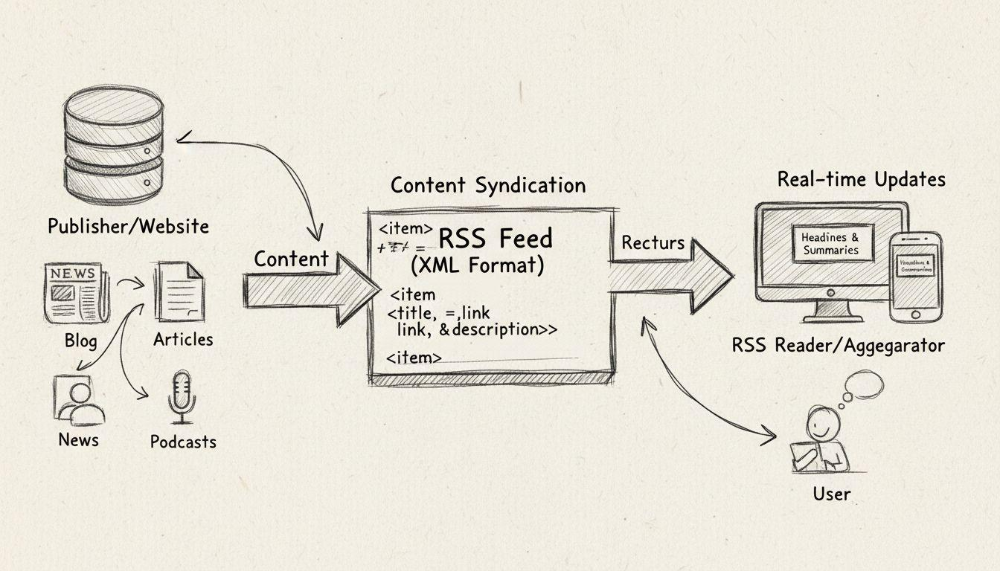

# TechPulse AI – Personal Technology Intelligence Platform



TechPulse AI is an AI-powered personal technology intelligence platform designed to discover, analyse, prioritise, and deliver relevant technology updates based on an individual's interests, learning goals, and career direction.

Instead of manually browsing multiple technology websites, blogs, and announcements, TechPulse AI automatically collects updates from trusted sources and uses AI to identify what matters most.

## 🎯 Problem Statement

Technology evolves rapidly, especially in AI, Generative AI, Cloud Computing, Software Engineering, and Product Management.

Keeping up with these developments across multiple sources is time-consuming. More importantly, not every announcement deserves attention.

TechPulse AI addresses this problem by transforming scattered technology updates into personalised, actionable intelligence.

## 💡 Core Objectives

- Automatically discover technology news and announcements from trusted sources.
- Collect and process updates using RSS feeds and public APIs.
- Remove duplicate articles and irrelevant information.
- Use AI to summarise updates and explain their significance.
- Evaluate relevance and priority based on personal interests and career goals.
- Recommend what to learn next and why it matters.
- Deliver important updates through email notifications and daily digests.

## 🚀 Key Features

### 1. Automated News Collection
Collect technology updates from official blogs, RSS feeds, GitHub releases, and other trusted sources.

### 2. AI-Powered Intelligence
Use Generative AI to:
- Summarise technology announcements.
- Explain why an update matters.
- Identify potential industry impact.
- Recommend relevant learning opportunities.

### 3. Intelligent Relevance Scoring
Prioritise updates using factors such as:
- Career relevance.
- Technology importance.
- Industry adoption.
- Learning opportunities.
- Recency.

### 4. Personalised Technology Insights
Deliver information aligned with individual interests, technical skills, and career development goals.

### 5. Notifications and Daily Digest
Send important technology updates and personalised daily summaries through email.

## 🛠️ Technology Stack

| Component | Technology |
|---|---|
| Programming Language | Python 3.13 |
| Package Management | uv |
| Backend API | FastAPI |
| News Collection | RSS, feedparser, HTTP APIs |
| AI Intelligence | Google Gemini |
| Database | PostgreSQL |
| ORM | SQLAlchemy |
| Scheduling | APScheduler |
| Frontend (Future) | React |
| Version Control | Git & GitHub |
| Containerisation | Docker |
| Cloud Deployment | Google Cloud Run |

The technology stack may evolve as the application grows.

## 🏗️ High-Level Architecture

```text
Technology Sources
       |
       v
RSS Feeds / Public APIs
       |
       v
Python News Collectors
       |
       v
Data Validation & Deduplication
       |
       v
AI Intelligence Engine
       |
       v
Relevance Scoring & Prioritisation
       |
       v
PostgreSQL Database
       |
       v
FastAPI Backend
       |
       v
Dashboard & Email Notifications
```

## 📅 Development Roadmap

- [ ] Milestone 1: RSS Feed Collection
- [ ] Milestone 2: Multiple Source Integration
- [ ] Milestone 3: Data Validation and Deduplication
- [ ] Milestone 4: PostgreSQL Integration
- [ ] Milestone 5: Gemini AI Summarisation and Analysis
- [ ] Milestone 6: Intelligent Relevance Scoring
- [ ] Milestone 7: FastAPI Backend
- [ ] Milestone 8: Personalised Dashboard
- [ ] Milestone 9: Automated Email Notifications
- [ ] Milestone 10: Dockerisation and Cloud Deployment
- [ ] Milestone 11: Monitoring, Security and Production Readiness

## 🎯 Long-Term Vision

TechPulse AI aims to become a personal technology intelligence assistant that not only tells users what is happening in technology but also explains:

- What happened?
- Why does it matter?
- How will it affect the industry?
- Why should I care?
- What should I learn or do next?

**The ultimate goal is to turn technology information into actionable knowledge and career growth.**

---

*Built as a hands-on learning and engineering project, with a focus on production-ready AI application development, system integration, and Forward Deployed Engineering practices.*